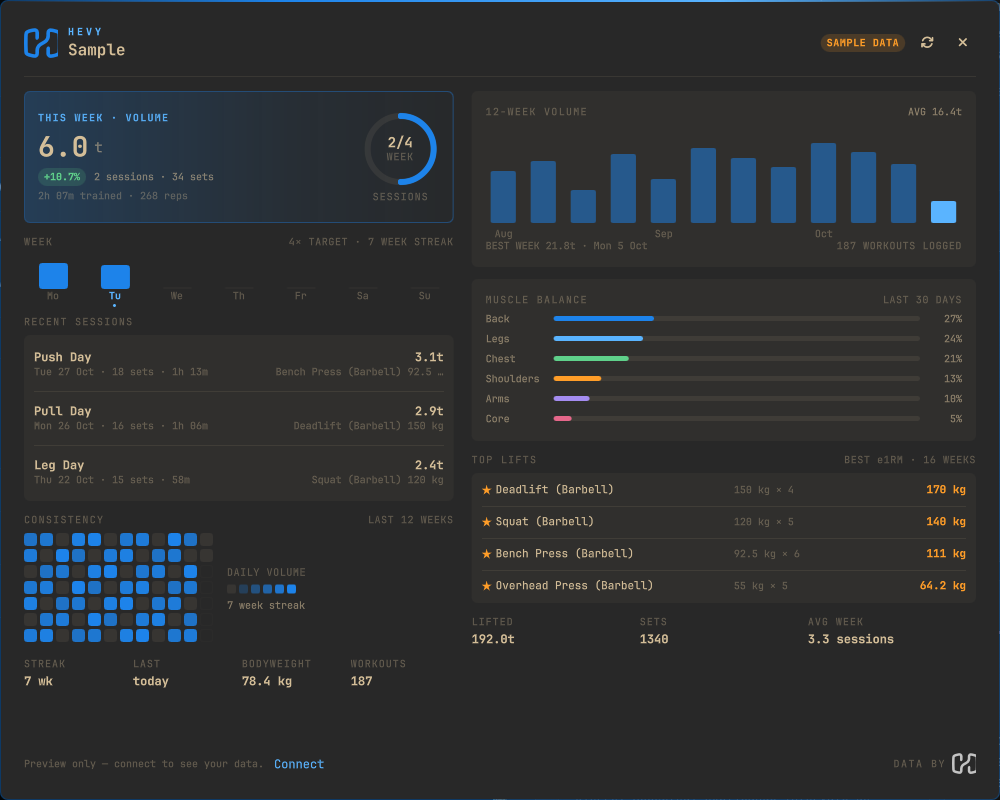

# Omahevy

A Hevy training dashboard for the [Omarchy](https://omarchy.org/) bar.

The bar shows the volume you have lifted this week. Click it and a full
dashboard opens in the center of the screen: weekly target, consistency
heatmap, 12-week volume trend, muscle balance, recent sessions and top lifts.



Not affiliated with or endorsed by Hevy. Everything runs locally and talks
directly to `api.hevyapp.com`; there is no third-party server.

## Features

- **Bar:** `H 18.4t` — this week's volume (or sessions when nothing weighted
  was logged yet). Blue accent, tooltip with week progress.
- **This week:** volume, sessions vs. weekly target, sets, reps and time.
- **Consistency:** 12-week heatmap plus current week strip and week streak.
- **Progress:** 12-week volume chart, best week, lifetime totals.
- **Muscle balance:** last 30 days of volume by muscle group.
- **Top lifts:** best estimated 1RM per exercise over the last 16 weeks.
- **Recent sessions:** date, sets, duration, volume and best set.
- **Fast:** 20-minute cache; middle-click the bar (or the refresh button) to
  force a sync.

## Requirements

- Omarchy 4 (Quattro) with the Quickshell shell.
- A Hevy account with API access (currently Hevy Pro). Create a key at
  <https://hevy.com/settings?developer>.
- `python3` — the sync helper only uses the standard library.

## Install

```sh
omarchy plugin add https://github.com/<your-username>/oma-hevy.git --enable
```

Then move it wherever you like in the bar:

```sh
omarchy bar move fbaroni.oma-hevy --section right
```

## Setup

1. Click `H —` in the bar.
2. Paste your Hevy API key and press **Connect Hevy**.
3. The key is verified against Hevy, then stored locally in
   `~/.config/omarchy/hevy/config.json` with mode `0600`.

Want to see the layout first? Click **Preview sample** — it renders a demo
dashboard without touching your account.

## Usage

| Action | Result |
| --- | --- |
| Left click the bar | Open/close the centered dashboard |
| Middle click the bar | Force a fresh sync |
| `Escape` or click outside | Close the dashboard |
| Refresh button | Force a fresh sync |
| Disconnect button | Delete the local key and cache |

The dashboard also answers IPC, so you can bind it:

```sh
omarchy-shell fbaroni.oma-hevy toggle
```

## Configuration

`~/.config/omarchy/hevy/config.json`:

```json
{
  "api_key": "…",
  "weekly_target": 4
}
```

`weekly_target` drives the sessions ring and the `4× TARGET` label (default 4,
clamped to 1–14). Edit it and reopen the dashboard.

Cached data lives in `~/.cache/omarchy/hevy/` (`snapshot.json`, plus an
`exercise-templates.json` catalogue used for muscle attribution).

## Privacy

- API key: only sent to `api.hevyapp.com` in the `api-key` header.
- No analytics, no telemetry, no third-party proxy.
- Removing the plugin leaves the key behind on purpose; use **Disconnect** or
  delete `~/.config/omarchy/hevy` and `~/.cache/omarchy/hevy` to wipe it.

## Development

```sh
git clone https://github.com/<your-username>/oma-hevy.git
cd oma-hevy

make validate   # omarchy plugin validate .
make test       # node --test tests/
make demo       # sample snapshot as pretty JSON
make install    # copy the working tree into ~/.config/omarchy/plugins
```

The plugin is a normal Omarchy shell plugin:

```
manifest.json      plugin contract (bar-widget)
BarWidget.qml      bar pill; loads the dashboard
Panel.qml          centered dashboard overlay
Model.js           formatting/chart helpers (tested with node)
bin/hevy-sync.py   fetch + aggregate snapshot (JSON on stdout)
bin/hevy-key.py    save/test/clear the local key
lib/hevy_api.py    Hevy client, cache and snapshot maths
```

Saving files under `~/.config/omarchy/plugins/fbaroni.oma-hevy/` hot-reloads
the plugin. After structural changes to `Panel.qml`, restart the shell once
(`omarchy restart shell`) so the overlay window is rebuilt cleanly.

## Publish it

1. Push this folder to a **public** GitHub repository.
2. Open the Omarchy plugin marketplace submission form:
   <https://github.com/omacom/omarchy-plugin-marketplace/issues/new?template=submit-plugin.yml>
3. Use the repo URL, category **Widgets**, and tags **Bar** + **Quickshell**.
   Suggest **Fitness** as a missing tag (the marketplace only accepts 1–3
   existing tags per submission).

The marketplace indexes the root `manifest.json`, so keep the ID
`fbaroni.oma-hevy` stable after the first release.

## Credits

The bar widget wiring (`BarWidget.qml`: panel loader, injection and popout
handling) follows [nathanrgagnon/omawhoop](https://github.com/NathanRGagnon/omawhoop)
(MIT), which itself follows the pattern of Omarchy's built-in clock and weather
widgets. The panel, data model, Hevy client and tests are original to Omahevy.

## License

MIT — see [LICENSE](LICENSE).
